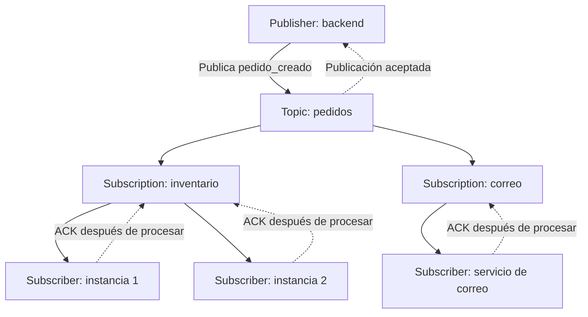

# Google Cloud Pub/Sub: notas explicadas

## 1. Qué es y qué problema resuelve

Pub/Sub significa Publish/Subscribe: publicar y suscribirse. Es un servicio administrado de mensajería asíncrona que conecta sistemas productores de mensajes con sistemas consumidores.

Imagina una tienda: cuando se confirma un pedido, necesitas actualizar inventario, mandar un correo y guardar el evento para análisis. Con Pub/Sub, la aplicación publica el evento y cada proceso puede atenderlo por separado.

Asíncrono significa que el productor no espera a que todos los consumidores terminen su trabajo. Sí debe comprobar que la publicación se completó correctamente.

Desacoplamiento significa que el productor no necesita conocer las direcciones ni la implementación de todos los consumidores. Pub/Sub actúa como intermediario y absorbe temporalmente diferencias entre la velocidad de producción y de consumo.

Se utiliza para sistemas orientados a eventos, intercambio de mensajes entre servicios e ingesta de datos en streaming. No necesitas administrar servidores de mensajería; Google gestiona la infraestructura y su escalamiento. Tú configuras los recursos y operas tus aplicaciones, permisos, cuotas y monitoreo.

Fuente: https://docs.cloud.google.com/pubsub/docs/overview

## 2. Las piezas que debes distinguir

| Concepto | Qué es | Ejemplo |
|---|---|---|
| Publisher | Aplicación que publica mensajes | Backend de la tienda |
| Message | Información enviada | Evento pedido_creado |
| Topic | Recurso al que se publican los mensajes | pedidos |
| Subscription | Recurso asociado a un topic, con su propio estado de entrega y confirmación | pedidos-inventario |
| Subscriber | Aplicación que recibe mensajes mediante una subscription | Servicio de inventario |

**La subscription no es la aplicación.** Es el recurso de Pub/Sub que la aplicación utiliza para consumir. El publisher publica al topic; el subscriber consume mediante una subscription.

Un topic puede tener varias subscriptions. Cada subscription pertenece a un solo topic.

**Subscriptions diferentes:** cada una puede recibir el mismo evento y procesarlo de manera independiente.

**Varios subscribers en una misma subscription:** comparten el trabajo. No esperes que cada instancia reciba todos los mensajes; pueden ocurrir reentregas.

Para que correo e inventario reciban todos los pedidos, crea una subscription para cada propósito. Para acelerar inventario, agrega instancias consumidoras a su misma subscription.

Fuente: https://docs.cloud.google.com/pubsub/docs/pubsub-basics

## 3. Diagrama del funcionamiento



Las flechas hacia inventario y correo representan entregas independientes del mismo evento. Las dos instancias de inventario se reparten el trabajo. Las flechas ACK confirman el procesamiento para la subscription correspondiente.

## 4. Qué contiene un mensaje

Un mensaje tiene un payload, es decir, los datos enviados; puede incluir atributos de tipo clave-valor. JSON es una opción común para el payload, no un formato obligatorio.

Ejemplo conceptual:

```json
{
  "data": {
    "event_id": "evt-001",
    "pedido_id": 123,
    "total": 850
  },
  "attributes": {
    "tipo": "pedido_creado",
    "pais": "MX"
  }
}
```

Este ejemplo muestra el contenido lógico. En la API REST, `data` se envía como bytes codificados en Base64. Las bibliotecas cliente manejan parte de esa representación.

## 5. Cómo se entrega: pull, push y exportación

| Modalidad | Quién inicia la entrega | Ejemplo |
|---|---|---|
| Pull | El cliente consumidor solicita mensajes | Aplicación Python o pipeline Dataflow |
| Push | Pub/Sub envía una solicitud HTTP al endpoint configurado | Servicio HTTP en Cloud Run |
| Exportación a BigQuery | Pub/Sub escribe directamente al destino | Tabla para análisis |
| Exportación a Cloud Storage | Pub/Sub escribe directamente al destino | Archivos en un bucket |

En pull, las bibliotecas suelen utilizar StreamingPull: una conexión persistente para recibir mensajes; no necesitas programar consultas repetitivas manualmente.

En push, una respuesta HTTP de éxito admitida por Pub/Sub confirma la entrega. No todas las modalidades usan un ACK explícito mediante la API.

BigQuery y Cloud Storage son subscriptions de exportación, no subtipos de push HTTP. La documentación actual también contempla exportación a Bigtable en Preview.

Por defecto, las subscriptions ofrecen entrega al menos una vez y no garantizan orden. Puedes habilitar orden para mensajes con la misma ordering key bajo las condiciones del servicio; no implica un orden global de todos los eventos.

Fuente: https://docs.cloud.google.com/pubsub/docs/subscription-overview

## 6. Vida del mensaje y los dos tipos de confirmación

1. El publisher envía el mensaje al topic.
2. Pub/Sub acepta y almacena el mensaje. La respuesta de publicación confirma la aceptación, no el procesamiento de negocio.
3. El evento queda disponible para las subscriptions correspondientes.
4. Pub/Sub lo entrega mediante la modalidad configurada.
5. El consumidor realiza su trabajo y confirma mediante ACK o el mecanismo de su modalidad.

**Publicación aceptada:** Pub/Sub recibió el evento.

**ACK de consumo:** la subscription recibió la confirmación del consumidor. Pub/Sub no inspecciona tu base de datos para verificar que el trabajo se realizó; tu código debe confirmar en el momento correcto.

Por eso, normalmente primero guardas el resultado y después confirmas. Si confirmas antes y la aplicación falla, puedes dejar trabajo incompleto sin una reentrega automática.

## 7. Qué pasa si el consumidor falla

El ack deadline es el plazo para confirmar una entrega. Si vence sin confirmación, el mensaje puede volver a entregarse. Un NACK solicita reentrega según la política de reintentos. Las bibliotecas pueden extender el plazo mientras se procesa.

**Backlog** es la acumulación de mensajes pendientes. Si el consumidor se detiene, los pendientes pueden conservarse, pero solo dentro de la retención configurada: Pub/Sub no los guarda indefinidamente.

El estado de confirmación es independiente por subscription: el ACK de inventario no confirma el trabajo de correo.

Confirmar tampoco equivale siempre a borrar físicamente el mensaje inmediatamente. La retención de mensajes confirmados o la retención del topic pueden permitir conservarlo y reproducirlo mediante seek. Normalmente crea tus subscriptions antes de publicar; una subscription nueva no recibe automáticamente todo el historial previo.

Fuentes: https://docs.cloud.google.com/pubsub/docs/reference/rest/v1/projects.subscriptions y https://docs.cloud.google.com/pubsub/docs/replay-overview

## 8. Duplicados e idempotencia

Con entrega al menos una vez, un mismo evento puede llegar nuevamente. Ejemplo: el servicio guarda un pedido, pero falla antes de confirmar. Pub/Sub reentrega y el servicio debe reconocer que ya lo procesó.

**Idempotencia:** procesar nuevamente el mismo evento no duplica el efecto. Puedes usar un `event_id` con restricción única y una operación transaccional que registre el evento y aplique el cambio.

Exactly-once delivery es una opción para subscriptions pull, incluida StreamingPull, con garantía regional. Tras un ACK exitoso no se reentrega ese mensaje; antes de confirmarlo todavía puede haber reentrega si vence el plazo.

Esta opción no convierte tus operaciones de negocio en una transacción única. Tampoco elimina dos publicaciones separadas del mismo evento de negocio con IDs de mensaje distintos. Mantén un diseño idempotente cuando corresponda.

Fuente: https://docs.cloud.google.com/pubsub/docs/exactly-once-delivery

## 9. Filtros y dead-letter topic

**Filtro:** se configura en la subscription para recibir solo mensajes cuyos atributos cumplen una condición. Ejemplo: `attributes.pais = "MX"`. El filtro de subscription no consulta campos dentro del JSON del payload. Pub/Sub confirma automáticamente los mensajes que no coinciden para esa subscription.

Fuente: https://docs.cloud.google.com/pubsub/docs/subscription-message-filter

**Dead-letter topic:** topic al que Pub/Sub puede reenviar mensajes que fallan repetidamente, cuando configuras una política de dead lettering en la subscription.

Ejemplo: un mensaje tiene un importe inválido y cada intento de procesamiento falla. Se reintenta y después puede reenviarse al dead-letter topic para revisión.

Debes configurar permisos apropiados y crear una subscription en ese topic para consumir los fallidos. El límite de intentos y el reenvío son aproximados, de mejor esfuerzo. El mensaje no se repara automáticamente.

Fuente: https://docs.cloud.google.com/pubsub/docs/dead-letter-topics

## 10. Pub/Sub, Dataflow y BigQuery

Pub/Sub transporta y distribuye mensajes. Dataflow permite ejecutar pipelines de procesamiento, como agregaciones por ventanas, enriquecimiento y transformaciones complejas. BigQuery almacena los resultados para análisis.

Ejemplo: una app publica eventos de compras; Dataflow calcula ventas por minuto y escribe el resultado en BigQuery.

Si solo quieres escribir mensajes compatibles en una tabla, puedes usar una subscription de BigQuery directamente. **Dataflow no es obligatorio.** Tampoco necesitas Dataflow para que una aplicación propia consuma mensajes.

## 11. Servicio global, ubicación y seguridad

Los topics y subscriptions tienen un espacio de nombres global. Eso no significa que puedas ignorar la ubicación de los datos.

El endpoint global es `pubsub.googleapis.com`; conecta con una región cercana desde la perspectiva de la red. Hay endpoints de ubicación y regionales para controlar el encaminamiento. La política de almacenamiento de mensajes controla las regiones permitidas para almacenamiento; no debes confundirla con elegir el endpoint del cliente. Para requisitos de residencia, revisa conjuntamente almacenamiento, endpoints y restricciones de procesamiento.

Fuentes: https://docs.cloud.google.com/pubsub/docs/reliability-intro y https://docs.cloud.google.com/pubsub/docs/resource-location-restriction

Pub/Sub cifra datos en tránsito y en reposo. Esto no equivale a cifrado de extremo a extremo entre aplicaciones con claves inaccesibles al servicio. IAM determina quién puede publicar, consumir y administrar recursos. Pueden emplearse claves administradas por el cliente cuando se requiere ese control.

Fuente: https://docs.cloud.google.com/pubsub/docs/encryption

## 12. Frase para recordar o explicar en entrevista

Pub/Sub desacopla productores y consumidores mediante topics y subscriptions. El productor publica al topic y cada subscription mantiene un consumo independiente. Los consumidores confirman las entregas, y el diseño debe contemplar reintentos, retención e idempotencia.

**Para decidir:** si distintos procesos necesitan el mismo evento, usa subscriptions diferentes. Si varias instancias deben repartirse un mismo trabajo, usa una subscription compartida.
